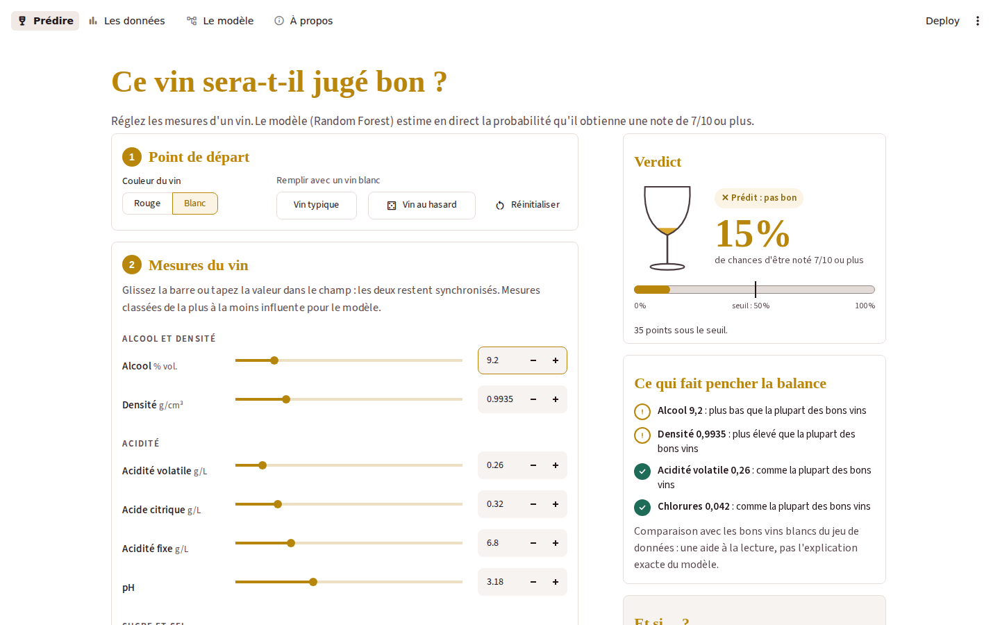
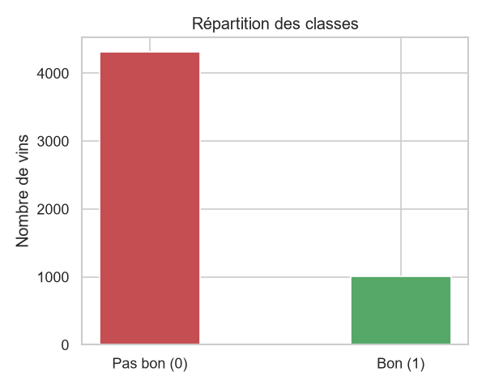
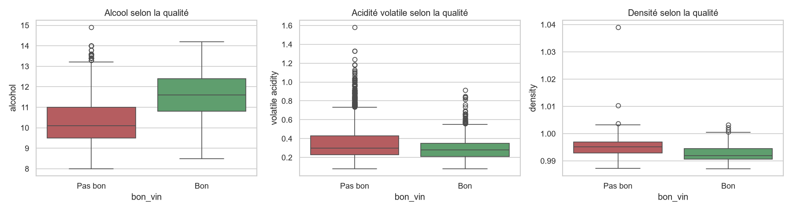
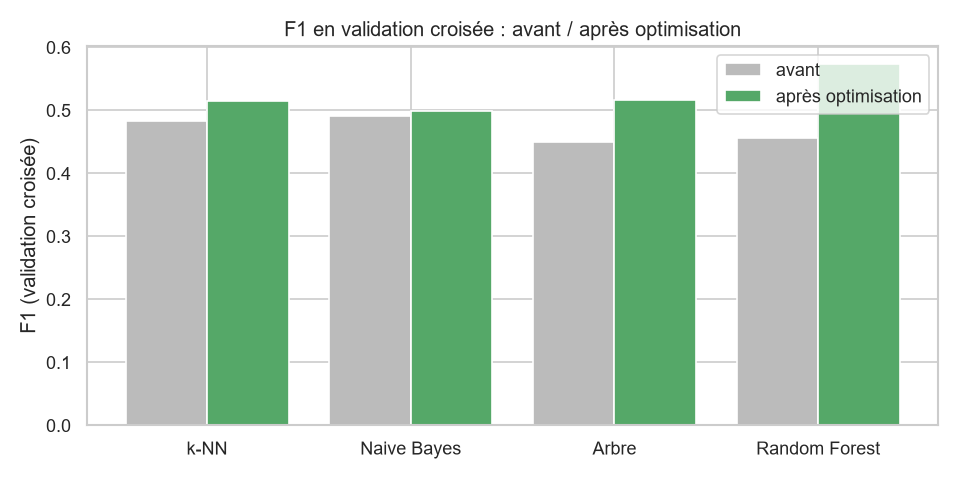
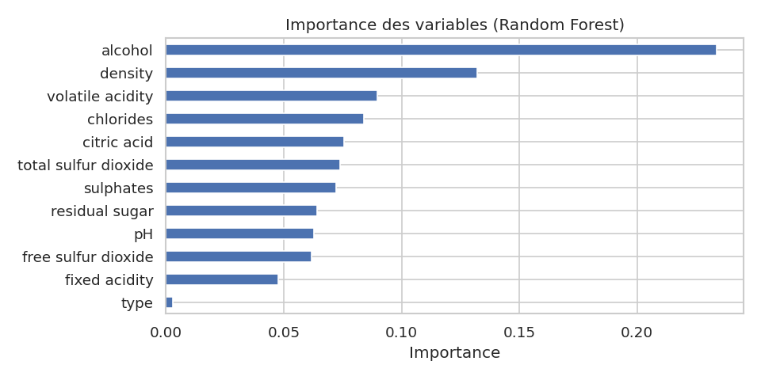
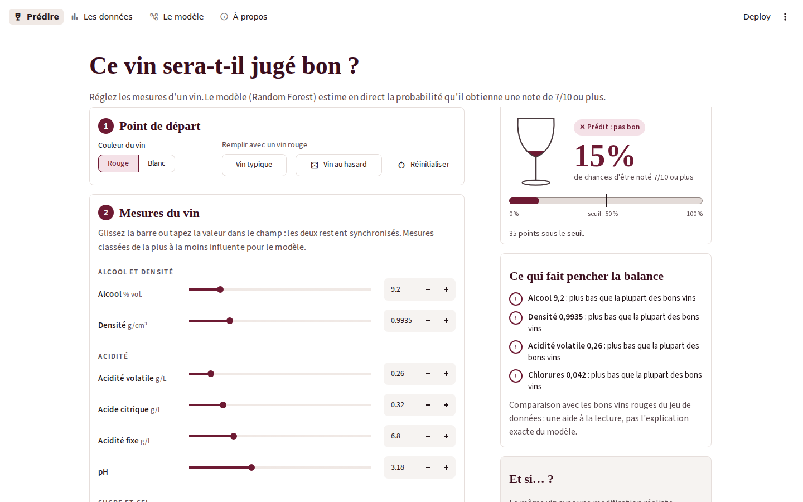

# 🍷 Qualité du vin — classification par Machine Learning

[](https://github.com/KYSyB2006/WineQualityClassificator/actions/workflows/ci.yml)


Projet de Machine Learning — **EFREI Paris, ING2-BDML, 2026/2027**
Binôme : **Awêro OKETOKOUN** & **Belva YONTA**

> **En une phrase :** à partir de 11 mesures physico-chimiques (alcool, acidité, sucre, soufre…), on prédit si un
> vin sera jugé **bon** (note ≥ 7/10) par des dégustateurs. Le modèle final, un **Random Forest** rééquilibré,
> obtient un **F1 de 0,57 en validation croisée** sur la classe « bon », contre 0,34 sur le test pour une régression
> logistique de base. Il est servi par une **application Streamlit**, empaquetée dans une **image Docker** et
> vérifiée à chaque push par **GitHub Actions**.



---

## Sommaire

1. [Le problème](#1-le-problème)
2. [Les données](#2-les-données)
3. [Démarche](#3-démarche)
4. [Résultats](#4-résultats)
5. [L'application](#5-lapplication)
6. [Structure du dépôt](#6-structure-du-dépôt)
7. [Installation et utilisation](#7-installation-et-utilisation)
8. [Docker](#8-docker)
9. [Intégration continue (GitHub Actions)](#9-intégration-continue-github-actions)
10. [Limites et pistes d'amélioration](#10-limites-et-pistes-damélioration)
11. [Références](#11-références)

---

## 1. Le problème

La qualité d'un vin dépend de nombreux paramètres mesurables en laboratoire : acidité, pH, degré d'alcool, sucre
résiduel, soufre… L'objectif est de construire un **modèle de classification supervisée** capable de prédire, à
partir de ces seules mesures, si un vin sera jugé :

- **bon** : note des dégustateurs **≥ 7 / 10** (classe 1) ;
- **pas bon** : note **< 7** (classe 0).

C'est un problème de **classification binaire déséquilibrée** : seulement 1 vin sur 5 est « bon ». L'accuracy est
donc trompeuse (un modèle qui répond toujours « pas bon » a déjà 81 % d'exactitude) : les modèles sont jugés sur le
**F1-score** et le **rappel** de la classe « bon ».

## 2. Les données

Jeu **Wine Quality** de l'[UCI Machine Learning Repository](https://archive.ics.uci.edu/dataset/186/wine+quality)
(Cortez et al., 2009) : vins portugais « Vinho Verde », rouges et blancs. Chaque note est la médiane d'au moins
3 évaluations d'experts.

| | Rouges | Blancs | Total |
|---|---:|---:|---:|
| Vins (fichiers bruts) | 1 599 | 4 898 | 6 497 |
| Doublons exacts retirés | | | 1 177 (18 %) |
| **Vins conservés** | **1 359** | **3 961** | **5 320** |
| Part de bons vins | 13,6 % | 21,6 % | 19,0 % |

Les deux premières parts sont calculées sur les fichiers bruts, la dernière après suppression des doublons.

**Variables (11 mesures + 1 indicateur de couleur)** : acidité fixe, acidité volatile, acide citrique, sucre
résiduel, chlorures, SO₂ libre, SO₂ total, densité, pH, sulfates, alcool, et `type` (rouge = 1, blanc = 0).

**Pourquoi fusionner rouges et blancs ?** Les deux jeux sont déjà déséquilibrés séparément, donc la fusion ne crée
pas de déséquilibre. Elle augmente fortement la quantité de données, et la colonne `type` conserve l'information de
couleur (les profils chimiques diffèrent : les blancs sont plus sucrés et bien plus soufrés, les rouges plus acides).
Aucune valeur manquante. Les 1 177 doublons exacts ont été supprimés pour éviter qu'un même vin se retrouve à la fois
dans l'entraînement et dans le test (fuite de données).

## 3. Démarche

Toute l'analyse est dans [`projet_vin.ipynb`](projet_vin.ipynb).

| Étape | Ce qui est fait |
|---|---|
| **1. Exploration** | Analyse des deux jeux séparément, puis fusion ; contrôle des valeurs manquantes et des doublons ; distributions, valeurs extrêmes (conservées : vrais vins atypiques), boxplots par classe |
| **2. Sélection des variables** | Matrice de corrélation (1re méthode), confirmée par l'importance des variables du Random Forest (2e méthode). Avec 12 variables seulement, toutes sont conservées |
| **3. Préparation** | Séparation 75 % entraînement / 25 % test, **stratifiée** (même proportion de bons vins des deux côtés) ; standardisation `StandardScaler` apprise sur l'entraînement uniquement |
| **4. Modèles de base** | Régression logistique, k-NN, arbre de décision, Naive Bayes gaussien, SVM (noyau RBF) |
| **5. Optimisation** | Grid Search + **validation croisée stratifiée à 5 plis**, critère F1 ; traitement du déséquilibre par `class_weight="balanced"` ; Random Forest en bonus |
| **6. Choix du modèle** | Comparaison avant / après optimisation, analyse du **compromis biais / variance** |
| **7. Mise en production** | Script d'entraînement, tests unitaires, application Streamlit, Docker, CI GitHub Actions |

<p align="center">
  
  
</p>

## 4. Résultats

### Modèles de base (jeu de test, classe « bon »)

| Modèle | Accuracy | Précision | Rappel | F1 | AUC |
|---|---:|---:|---:|---:|---:|
| k-NN (K = 5) | 0,826 | 0,551 | 0,452 | **0,497** | 0,796 |
| Naive Bayes | 0,744 | 0,394 | **0,659** | 0,493 | 0,765 |
| Arbre de décision | 0,771 | 0,402 | 0,433 | 0,417 | 0,641 |
| SVM (RBF) | **0,829** | **0,617** | 0,262 | 0,368 | 0,812 |
| Régression logistique | 0,817 | 0,538 | 0,250 | 0,341 | **0,822** |

Les modèles non linéaires (k-NN, Naive Bayes) sont les meilleurs au départ. La régression logistique et le SVM
classent bien les vins (AUC la plus haute) mais, par défaut, ils ne prédisent presque jamais « bon » : la gestion
du déséquilibre compte autant que la non-linéarité.

### Optimisation (F1 en validation croisée à 5 plis)

| Modèle | Avant | Après | Meilleurs réglages |
|---|---:|---:|---|
| k-NN | 0,483 | 0,514 | K = 3, distance de Manhattan, `weights="distance"` |
| Naive Bayes | 0,492 | 0,499 | `var_smoothing = 0,1` |
| Arbre de décision | 0,450 | 0,516 | profondeur 3, `entropy`, `class_weight="balanced"` |
| **Random Forest** (bonus) | 0,455 | **0,575** | `class_weight="balanced"`, `max_features="sqrt"`, ≥ 5 vins par feuille |



Sur le jeu de test, le Random Forest optimisé atteint un **F1 de 0,54** (précision 0,51, rappel 0,58, accuracy
0,82) : il retrouve 145 bons vins sur 252, contre 63 pour la régression logistique de base.

### Ce qu'on retient

- **Le déséquilibre est le principal obstacle.** `class_weight="balanced"` est le réglage qui aide le plus : il
  oblige le modèle à faire attention aux bons vins et fait grimper le rappel.
- **Biais / variance.** La régression logistique est trop simple (biais : elle rate les bons vins) ; l'arbre non
  bridé apprend l'entraînement par cœur (variance : F1 d'apprentissage de 1,00). Limiter sa profondeur le corrige ;
  le Random Forest, qui fait voter de nombreux arbres différents, offre le meilleur équilibre.
- **L'alcool est la variable clé**, suivie de la densité et de l'acidité volatile : la corrélation et l'importance
  du Random Forest donnent le même classement.

<p align="center">
  
</p>

### Modèle livré

`train.py` entraîne le modèle final sur **toutes** les données (5 320 vins) : `RandomForestClassifier` de 100 arbres,
`max_depth=12`, `max_features="sqrt"`, `class_weight="balanced"`, `random_state=42`, précédé d'un `StandardScaler`.
Il enregistre `modele_vin.joblib`, `scaler_vin.joblib` et `colonnes.joblib`, que l'application recharge.

## 5. L'application

Application web [Streamlit](https://streamlit.io) en 4 pages (`app.py`) :

| Page | Contenu |
|---|---|
| **Prédire** | Choix de la couleur et d'un exemple (vin typique, vrai vin tiré au hasard avec sa vraie note) ; 11 mesures réglables par une barre **ou** un champ de saisie synchronisés ; verdict en direct (probabilité, jauge, seuil de 50 %, « résultat serré » entre 40 et 60 %) ; mesures qui font pencher la balance ; scénarios « Et si… ? » recalculés par le modèle ; alerte si l'alcool et la densité forment une combinaison irréaliste |
| **Les données** | Chiffres clés, filtre rouges / blancs, répartition des notes, alcool selon la classe, corrélation de chaque mesure avec la note, données brutes |
| **Le modèle** | Fonctionnement du Random Forest, réglages retenus, importance des variables, figures du notebook |
| **À propos** | Objectif, démarche, limites |

Le thème suit la couleur choisie : bordeaux pour un vin rouge, doré pour un vin blanc. Sur téléphone, une barre en bas
de l'écran garde le verdict visible pendant le réglage.

<p align="center">
  
</p>

## 6. Structure du dépôt

```
WineQualityClassificator/
├── projet_vin.ipynb          # analyse complète : exploration, modèles, optimisation
├── train.py                  # entraîne le modèle final et crée les fichiers .joblib
├── app.py                    # application Streamlit
├── test_model.py             # tests unitaires (pytest)
├── requirements.txt          # librairies, versions figées
├── Dockerfile                # image Docker de l'application
├── .dockerignore
├── .streamlit/config.toml    # thème de l'application
├── .github/workflows/ci.yml  # intégration continue GitHub Actions
├── winequality-red.csv       # données UCI (vins rouges)
├── winequality-white.csv     # données UCI (vins blancs)
├── winequality.names         # description officielle du jeu de données
├── modele_vin.joblib         # modèle entraîné (créé par train.py)
├── scaler_vin.joblib         # standardisation (créée par train.py)
├── colonnes.joblib           # ordre des colonnes attendu par le modèle
├── fig_*.png                 # figures produites par le notebook
└── docs/                     # captures d'écran de l'application
```

## 7. Installation et utilisation

Prérequis : **Python 3.11**.

```bash
# 1. Récupérer le projet
git clone https://github.com/KYSyB2006/WineQualityClassificator.git
cd WineQualityClassificator

# 2. Créer un environnement virtuel et installer les librairies
python -m venv .venv
.venv\Scripts\activate          # Windows
# source .venv/bin/activate     # macOS / Linux
pip install -r requirements.txt

# 3. Entraîner le modèle (crée les 3 fichiers .joblib)
python train.py

# 4. Lancer les tests
python -m pytest -q

# 5. Lancer l'application → http://localhost:8501
streamlit run app.py
```

Les versions de `requirements.txt` sont figées : un fichier `.joblib` ne se recharge correctement qu'avec la même
version de scikit-learn que celle qui l'a créé. En cas de doute, relancer `python train.py`.

### Tests unitaires

`test_model.py` vérifie le modèle enregistré, exactement comme l'application l'utilise :

| Test | Vérifie que… |
|---|---|
| `test_nombre_de_colonnes` | le modèle attend 12 variables (11 mesures + le type) |
| `test_la_prediction_est_0_ou_1` | la prédiction vaut toujours 0 ou 1 |
| `test_les_probabilites_font_100_pourcent` | les probabilités « bon » et « pas bon » s'additionnent à 1 |
| `test_un_bon_vin_est_bien_detecte` | un vin très alcoolisé et peu acide obtient une probabilité plus élevée qu'un vin médiocre |

## 8. Docker

```bash
docker build -t qualite-vin .
docker run -p 8501:8501 qualite-vin
# puis ouvrir http://localhost:8501
```

Pendant la construction, l'image installe les librairies, **entraîne le modèle** puis **lance les tests** : si un
test échoue, l'image n'est pas créée. Le modèle est donc toujours produit dans le même environnement que celui où
tourne l'application. Un `HEALTHCHECK` interroge l'application toutes les 30 secondes : `docker ps` affiche
`healthy` quand elle répond.

## 9. Intégration continue (GitHub Actions)

Le workflow [`.github/workflows/ci.yml`](.github/workflows/ci.yml) se lance à chaque push et à chaque pull request :

1. **tests** : installation de Python 3.11 et des librairies, entraînement du modèle, tests `pytest` ;
2. **docker** : construction de l'image, démarrage du conteneur et vérification que l'application répond ;
3. **publication** (branche principale uniquement) : l'image est publiée sur GitHub Container Registry.

```bash
docker run -p 8501:8501 ghcr.io/kysyb2006/winequalityclassificator:latest
```

Le badge en haut de ce fichier indique si la dernière vérification a réussi.

## 10. Limites et pistes d'amélioration

- **Généralisation limitée** : les vins viennent d'une seule région portugaise et les notes sont subjectives ; le
  modèle ne s'applique pas tel quel à d'autres vins.
- **Déséquilibre** : même optimisé, le modèle fait des fausses alertes (précision ≈ 0,5). Le seuil de décision
  (50 %) pourrait être ajusté selon l'objectif : ne rater aucun bon vin, ou ne jamais se tromper quand on dit « bon ».
- **Variables corrélées** : alcool et densité sont fortement liés (−0,67) ; Naive Bayes, qui les suppose
  indépendants, en souffre.
- **Pistes** : ajustement du seuil par validation croisée, autres modèles d'ensemble (gradient boosting),
  explication locale des prédictions (valeurs SHAP), prédiction de la note exacte (régression).

## 11. Références

- P. Cortez, A. Cerdeira, F. Almeida, T. Matos et J. Reis. *Modeling wine preferences by data mining from
  physicochemical properties.* Decision Support Systems, Elsevier, 47(4):547-553, 2009.
  [doi:10.1016/j.dss.2009.05.016](http://dx.doi.org/10.1016/j.dss.2009.05.016)
- Jeu de données : [Wine Quality — UCI Machine Learning Repository](https://archive.ics.uci.edu/dataset/186/wine+quality)
- [Documentation scikit-learn](https://scikit-learn.org/stable/) · [Documentation Streamlit](https://docs.streamlit.io)
